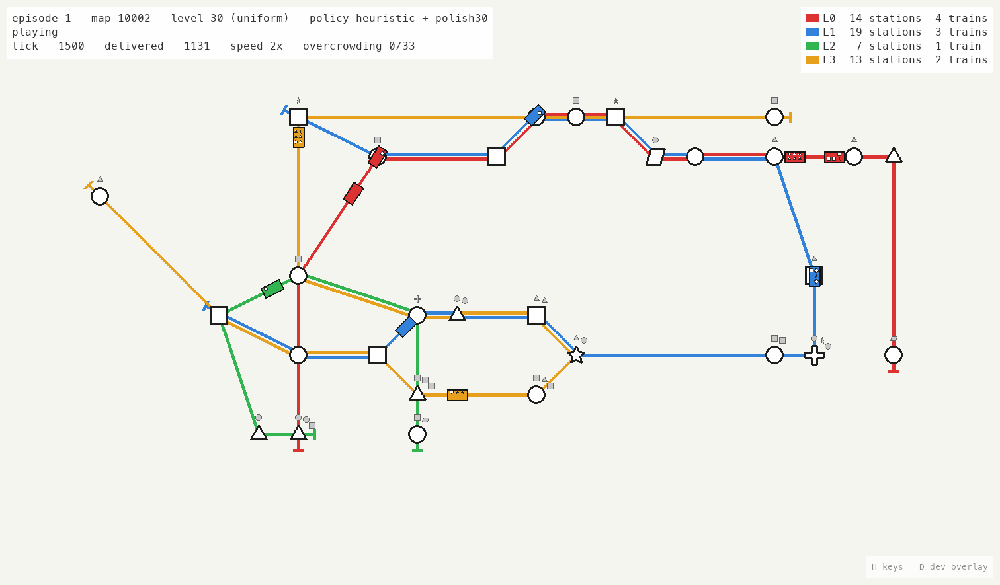
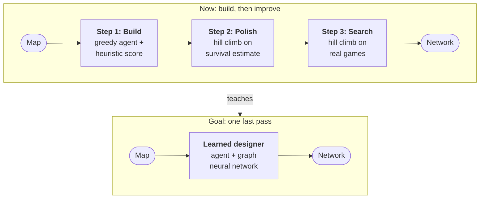
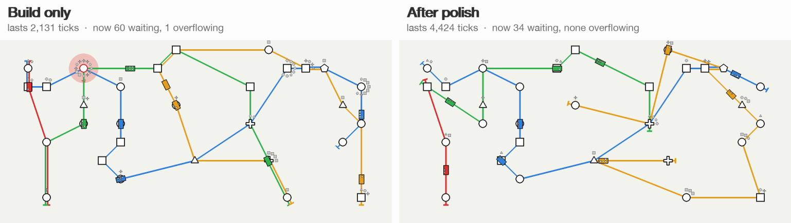

# Mini Metro Sim

A subway-building puzzle in the style of [*Mini Metro*](https://dinopoloclub.com/games/mini-metro/),
plus an AI that designs the networks.

You get a map of stations and a pool of lines and trains. Passengers show up faster and faster,
and the game ends when stations overcrowd. The goal is a network that lasts as long as possible.



*Gray shapes are waiting passengers, drawn as the shape they want to reach.*

> Independent project inspired by *Mini Metro* by Dinosaur Polo Club, for the intended purpose of simulation.
> Not affiliated with or endorsed by them.

## The Game

- 20–40 stations, each a shape, spread evenly, in towns, or along a corridor
- Each passenger heads for any station of one shape
- Up to 4 lines and 10 trains, and lines can't cross
- The game ends when stations stay overcrowded (more than 12 waiting) for too long
- The whole network is built before the first passenger arrives, then locked

Settings are in [config.yaml](src/minimetro/config.yaml).

## Design Overview



| Part | What it is | File |
|---|---|---|
| **Agent** | Builds a network move by move (extend a line, start one, add a train), always taking the best-scored move | [agent.py](src/minimetro/design/agent.py) |
| **Heuristic** | Hand-written move score, a weighted sum of terms like segment length, bends, reach and crowding | [heuristic.py](src/minimetro/design/heuristic.py) |
| **Survival estimate** | Queueing model that predicts how long a network lasts, in 4 ms, without playing it | [survival.py](src/minimetro/design/survival.py) |
| **Hill climb** | Tries small edits, keeps the best, and repeats | [search.py](src/minimetro/design/search.py) |
| **Simulator** | The real game | [simulator.py](src/minimetro/game/simulator.py) |

| Step | Method | Judged by | Time per map* |
|---|---|---|---|
| **1. Build** | Agent | Heuristic | Instant |
| **2. Polish** | Hill climb | Survival estimate | ~10 s |
| **3. Search** | Hill climb | Simulator (the estimate picks which edits to play) | ~2 min |
| **Learned designer** | Agent | Heuristic + graph neural network | ~0.5 s |

\* One CPU core, 30-station map.



*Same map and passengers at tick 2,164. The build-only network is about to fail at the red
station. Polish gains 2.1× on this map and 1.63× on average.*

### The learned designer

This is the goal optimizer. It's the same agent plus a graph neural network (GNN) that adjusts
the heuristic's score for each move, aiming for search-quality networks in one fast pass, even
on unseen maps.

The GNN reads the half-built design as a graph. It never sees screen positions or shape names,
so every map size looks alike to it.

| Input | Features |
|---|---|
| Stations | Crowding, waiting and incoming passengers, lines through it, reachable shapes, isolation |
| Links | Built segments and 6 nearest neighbors, with distance, direction, trains and load |
| Map | Lines and trains left, unconnected stations, worst crowding |
| Moves | Type, length, bend, load created, demand served |

**Output:** one score adjustment per move. These start at zero, so an untrained designer plays
exactly like the heuristic.

It learns by **branch and compare** (swap one decision, replay with the same passengers, see
which lasted longer) or by **imitating** the networks polish and search produce. Neither beats
the heuristic yet.

## Design Challenges

As a networking problem, the number of possible networks grows exponentially as more nodes are introduced. In addition, the game adds constraints and randomness the designer has to account for. Some of the main challenges and approaches are listed below.

| Challenge | Approach |
|---|---|
| **Choices ripple:** Early node connections change about half of the later ones. | Use a heuristic to build a decent network first, then fix it with edits. |
| **Luck:** The same network varies about 15% from game to game. | Use averaging. Run edits multiple times, and keep only if better on average. |
| **Games are slow:** About 0.2 s each, too slow for thousands of tries per map. | Screen edits with the estimate and play only the promising ones. |
| **Late feedback:** A game gives one score at the very end, so there's no way to tell which of the 30–70 moves helped. | Change one move, replay both networks with the same passengers, and credit the difference to that move. |
| **Maps vary:** Designers meet sizes and layouts they've never seen. | Keep positional information out of the GNN's input, and normalize. Test on held-out sizes and layouts. |
| **Local max:** Classic hill-climbing issue. How much the edits improve a network depends heavily on the starting network, tying back to the first challenge. | Climb from several starting networks and keep the one with the best survival estimate. |

## Results

300 test maps (30, 35 and 40 stations), 5 games each, capped at 10,000 ticks, compared with
the build step map by map.

| Designer | Survival vs build | 95% CI |
|---|---|---|
| Build | 1.00× (mean 1,644 ticks) | |
| Build + polish | **1.63×** | 1.58–1.68 |
| Build + polish + search\* | **1.89×** | 1.78–2.02 |

\* On 120 of the maps (40 per size).

Raw results are in [results/](results/).

## Getting Started

Developed on Python 3.13.

```bash
python -m venv .venv
source .venv/bin/activate

# the minimetro package and its dependencies, editable
pip install -e .

# pytest and hypothesis, for the tests
pip install -r requirements-dev.txt
```

| To | Run |
|---|---|
| Build a network by hand | `python scripts/play.py --level 30` |
| Watch the AI design and play | `python scripts/run_visual.py` |
| Step through its decisions | `python scripts/run_visual.py --heuristic --dev --search 0` |
| Benchmark a designer | `python scripts/bench.py heuristic --polish 30 --maps 10` |
| Run the fast tests (~40 s) | `pytest -m "not slow"` |
| Train the learned designer | `python scripts/train.py` |
| Make teacher data, then imitate it | `python scripts/teach.py --maps 1000`, then `python scripts/imitate.py` |

Press H in a game window to see its keys.

> [Note]
> `python scripts/bench.py heuristic` rewrites `results/heuristic.json`, the file every other run
> is compared against. Instead run with specified maps, like `--maps 10`, as they write `heuristic_m10.json` instead.

`scripts/train.py` continues training `checkpoints/v4/` and replaces `checkpoints/v4_best/` only when validation improves.
For a fresh run, use `python scripts/train.py --out checkpoints/v5`.

## Details

<details>
<summary><b>More on polish and search</b></summary>

- The estimate routes passengers the way the game does, works out queues between trains and
  riders left behind, then adds up overcrowding as arrivals speed up.
- Its tick counts are rough, but it reliably picks the better of two networks on one map.
- Edits move or add a train, trim, extend or shift a line's end, or reverse part of a line.
- Polish tries 40 edits a round for 30 rounds. `--restarts N` climbs from N starts and keeps
  the best.
- Search lets the estimate pick 7 of 40 edits a round and plays them on 4 fresh passenger
  seeds. It keeps the best edit only if it beats the current network by more than chance.

</details>

<details>
<summary><b>Benchmark suites</b></summary>

| Suite | Maps | Cap (ticks) | Use |
|---|---|---|---|
| `test` (default) | 30, 35, 40 stations, all layouts | 10,000 | Headline numbers. 40 stations and corridors are never trained on. |
| `val` | 30, 35 stations, even and town layouts | 10,000 | Tuning, picking checkpoints |
| `classic` | The original 20-station maps | 6,000 | Comparing with older runs |

- Test maps use seeds from 10,000, validation from 20,000 and training 0–9,999, so they never
  overlap.
- Every run plays the same maps and passengers, so any two runs compare map by map.
- The older folders `crossings_allowed/`, `squared_targets/` and `levels_cap6000/` used
  earlier rules or caps and aren't comparable.

</details>

<details>
<summary><b>Code map</b></summary>

```
src/minimetro/   the package: game/, design/, learning/, plus bench, viewer, config
scripts/         what you run
results/         benchmark results
checkpoints/     trained weights
tests/  experiments/  docs/
```

| Folder | File | What it does |
|---|---|---|
| `src/minimetro/` | [config.yaml](src/minimetro/config.yaml), [config.py](src/minimetro/config.py) | All settings and folder paths |
| | [bench.py](src/minimetro/bench.py) | The benchmark |
| | [viewer.py](src/minimetro/viewer.py), [showcase.py](src/minimetro/showcase.py) | Pygame viewer, and showing a designer at work |
| `game/` | [maps.py](src/minimetro/game/maps.py) | Map generator (station count, layout, levels) |
| | [objects.py](src/minimetro/game/objects.py), [point.py](src/minimetro/game/point.py) | Stations, lines, trains, passengers, geometry |
| | [simulator.py](src/minimetro/game/simulator.py) | The game loop |
| | [rules.py](src/minimetro/game/rules.py) | Build moves and which are legal |
| `design/` | [metrics.py](src/minimetro/design/metrics.py) | Measurements of a network before play |
| | [heuristic.py](src/minimetro/design/heuristic.py) | Candidate moves and the hand-written score |
| | [agent.py](src/minimetro/design/agent.py) | Builds a network, and runs polish and search |
| | [survival.py](src/minimetro/design/survival.py) | The survival estimate |
| | [search.py](src/minimetro/design/search.py) | Edits, polish and search |
| | [playouts.py](src/minimetro/design/playouts.py) | Plays networks in parallel |
| | [mcts.py](src/minimetro/design/mcts.py) | Optional Monte Carlo look-ahead for the agent |
| `learning/` | [model.py](src/minimetro/learning/model.py) | The GNN (two graph attention layers, then a move scorer) |
| | [training.py](src/minimetro/learning/training.py) | Branch and compare |
| | [imitation.py](src/minimetro/learning/imitation.py) | Imitation |
| | [ga.py](src/minimetro/learning/ga.py) | Genetic algorithm, an older approach that evolves whole networks |
| `scripts/` | [play.py](scripts/play.py) | Build a network by hand |
| | [run_visual.py](scripts/run_visual.py) | Watch the AI design and play |
| | [bench.py](scripts/bench.py) | Benchmark a designer |
| | [train.py](scripts/train.py) | Train the learned designer (branch and compare) |
| | [teach.py](scripts/teach.py), [imitate.py](scripts/imitate.py) | Make teacher designs, then train the student on them |
| | [ga_train.py](scripts/ga_train.py) | Train the genetic algorithm |
| | [collect_edits.py](scripts/collect_edits.py) | Log every edit search tries |
| [tests/](tests/) | | Tests. After an intended design change, regenerate the golden file with `python -m tests.test_regression`. |
| [experiments/](experiments/) | | One-off studies |

Changing a game setting changes every result, so re-run the heuristic baseline before
comparing with old numbers.

</details>
